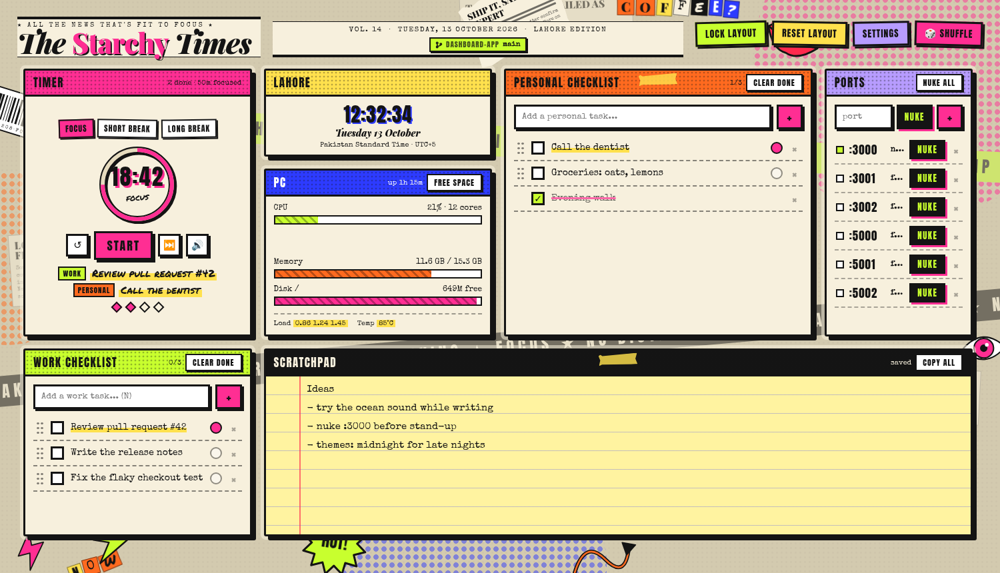
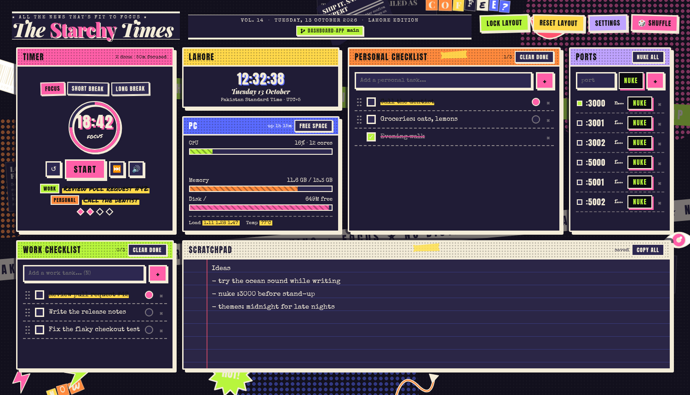

# The Starchy Times

A pomodoro timer and daily dashboard for the screen you only glance at, dressed up as a
newspaper collage. Everything runs locally on your machine. No account, no cloud, no tracking.



<details>
<summary>Midnight theme</summary>



</details>

## What's in it

| Panel | What it does |
|---|---|
| **Timer** | Focus, short break and long break with lengths you choose. Faint ambient sound while it runs, a chime when a phase ends. It remembers where it was, even after a crash or restart. |
| **Work + Personal checklists** | Click a task to edit it, drag it to reorder, or drag it into the other list. The round button makes it the task the timer shows. |
| **Clock** | Lahore time (Asia/Karachi). |
| **PC** | CPU, memory, disk, load and temperature, plus a **Free space** button that shows what it can clear (Trash, npm/pip caches, thumbnails, leftover test-browser folders) before it deletes anything. |
| **Ports** | Type a port and press **Nuke**. It finds the process, including the parent that would restart it, and stops it. One click for your usual dev ports. |
| **Scratchpad** | A big notepad that saves as you type, with proper undo and redo. |
| **Branch pills** | The git branch of each repo you list, with uncommitted changes and ahead/behind. |

Panels can be dragged by their title bar and resized from any edge or corner, and the rest
shuffle out of the way. **Lock layout** freezes them, **Reset layout** puts them back.

## Install

You need Linux with Node.js 18+. For the standalone window you also need GTK 3 and WebKit2GTK 4.0
(Ubuntu 22.04 has them).

```bash
git clone https://github.com/umaisusmani/starchy-times.git
cd starchy-times
./setup.sh
```

`setup.sh` checks your system, installs the npm packages and prints how to start it.

## Run

```bash
python3 launch.py        # desktop window
node server.js           # or: just the server, then open http://127.0.0.1:9876
```

Want a short command? Add this to `~/.bashrc`, then run `dashboard`:

```bash
alias dashboard='python3 /path/to/starchy-times/launch.py &'
```

## Using it

| Keys | |
|---|---|
| `Space` | start / pause the timer |
| `R` | reset the current phase |
| `N` | jump to the work checklist's input |
| `Ctrl+Z` / `Ctrl+Shift+Z` | undo / redo in the scratchpad |

**Settings** (top right) has timer lengths, auto-start, sound choice and volume, and the theme.

**Themes:** Newsprint, Midnight, Candy, Forest, Sunset, Mono.

**Sounds:** 19 field recordings plus brown, pink and white noise, with a Preview button.

- Nature: forest and birds, night countryside, cicadas, frog pond, wind in the trees
- Water and rain: mountain stream, gentle brook, small waterfall, ocean waves, rain, rain on glass, rain in a tent
- Cozy: fireplace, warm machine hum
- Travel: train carriage, ferry engine, highway hum
- City: city street, cafe

**Your own pictures:** drop small images (under 600 KB each) into `public/collage/` and they
join the collage. Hit **Shuffle** to re-roll the layout of the art.

## Your data

Tasks, scratchpad, layout, timer state and settings live in the `data/` folder next to the app.
It is git-ignored, so it is never uploaded. Back it up by copying the folder.

## Settings you can change with environment variables

| Variable | Meaning | Default |
|---|---|---|
| `POMO_PORT` | server port | `9876` |
| `POMO_DATA_DIR` | where your data is stored | `./data` |
| `POMO_REPOS` | colon-separated git repos for the branch pills | none |
| `POMO_GPU` | set to `1` to use GPU compositing in the window | off |
| `POMO_TMP_DIR` | folder scanned for leftover test-browser profiles | `/tmp` |

Example: `POMO_REPOS=~/work/api:~/work/web python3 launch.py`

## It's built to be light

A low-RAM machine was the reason this exists, so the window uses about 200 MB.

- No web framework on the server, just a ~90-line router (`mini-http.js`).
- Software compositing and an in-memory web session in the window.
- Ambient sounds are mono 32 kHz and looped in place, so only one is ever in memory.
- Polling slows down and pauses while the window is hidden.
- If the page or the server crashes, the launcher brings it back, and saves are atomic so a
  crash can't corrupt your data.

## Troubleshooting

**The window doesn't open.** Run `python3 -c "import gi; gi.require_version('WebKit2','4.0')"`.
If that errors, install `python3-gi` and `gir1.2-webkit2-4.0`, or use `node server.js` and a browser.

**"Address already in use".** Another copy is running. Close it or use another port: `POMO_PORT=9900 node server.js`.

**No sound.** Sound starts with the timer, so press Start. Check Settings: the sound is on and
the volume isn't at zero. **Preview** plays it without the timer.

**The window looks glitchy or sluggish.** Try `POMO_GPU=1 python3 launch.py`.

**Panels are in a weird place.** **Reset layout** in the top bar.

**The port Nuke says it couldn't stop something.** That process belongs to another user. The
panel shows the exact `sudo` command to run.

## Credits

- Field recordings by Joseph Sardin, [BigSoundBank.com](https://bigsoundbank.com), released
  under [CC0 1.0](https://creativecommons.org/publicdomain/zero/1.0/). They were trimmed to at most 150 s,
  made mono, and loudness-matched.
- Panel layout by [GridStack](https://gridstackjs.com/) (MIT).
- Fonts via [Fontsource](https://fontsource.org/): Anton, Playfair Display, Special Elite, Permanent Marker (all SIL OFL).
